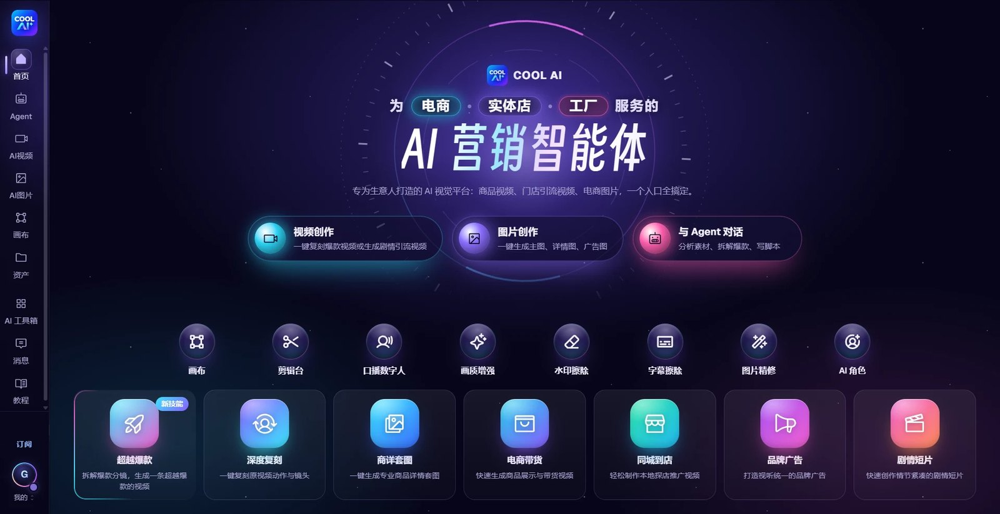
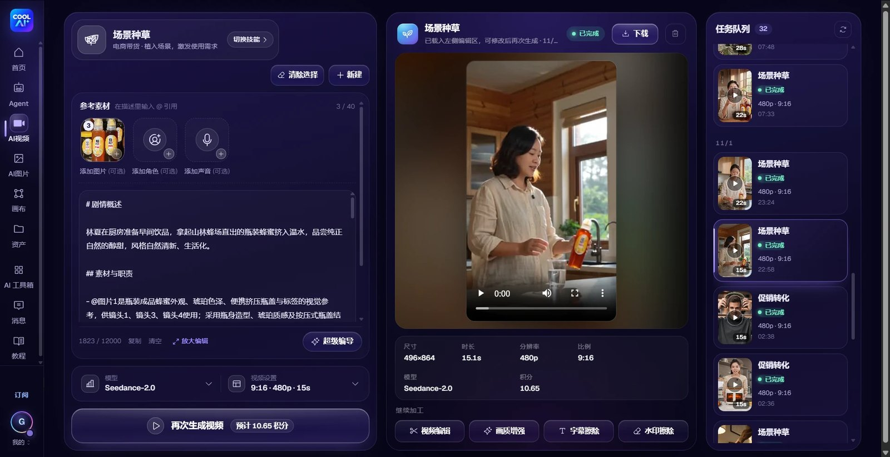
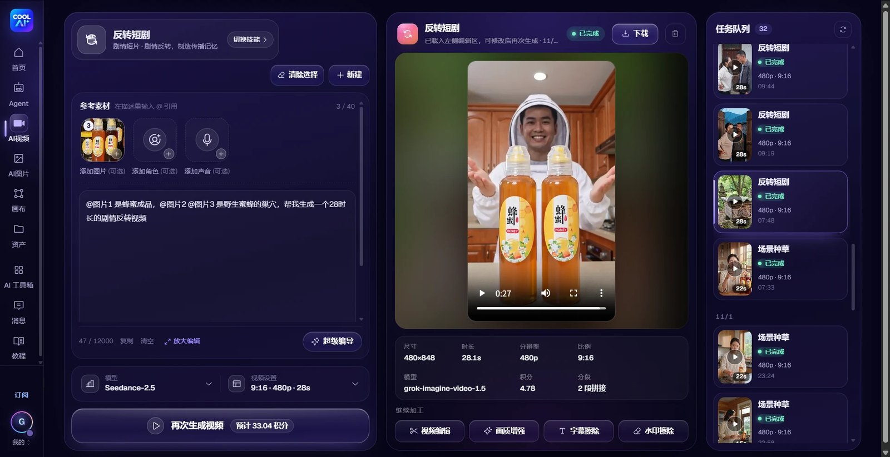
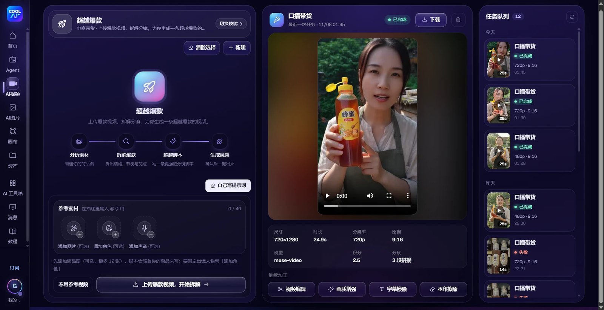
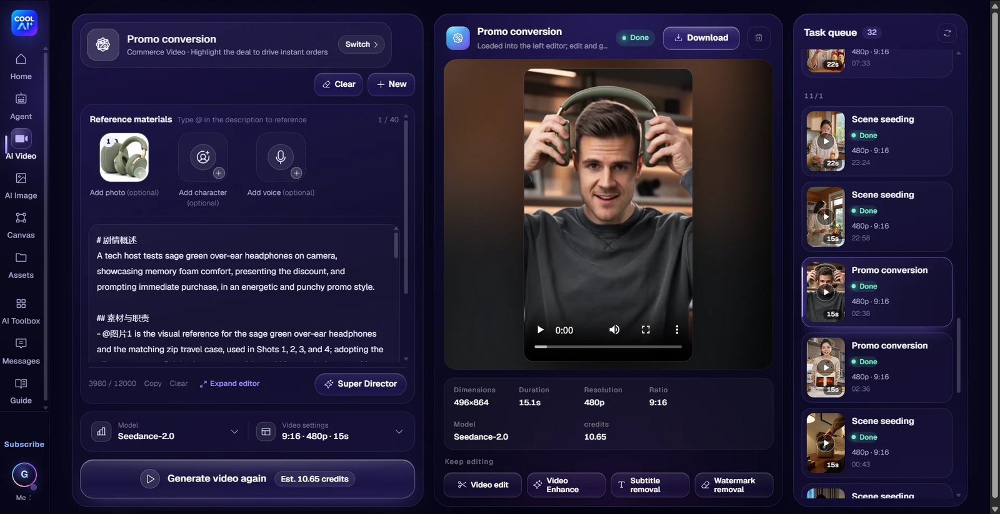
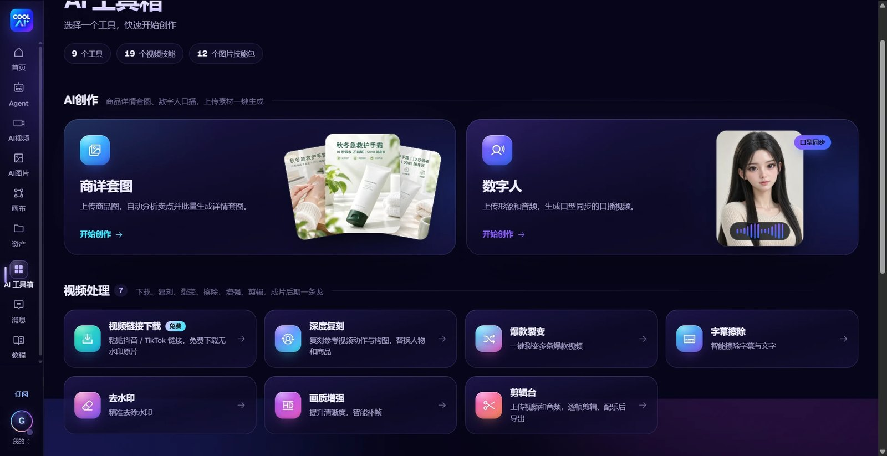

# COOL AI Skill · 酷AI 技能

**简体中文** | [English](#english)

<p align="center"></p>

让你的 AI 编程助手直接调用 [COOL AI（酷AI）](https://www.coolai.mov) 生成营销视频和图片。
支持 **Claude Code、Codex、WorkBuddy、DeepSeek Harness**，以及其它支持 `SKILL.md` 的工具。

## 能做什么

- **AI 视频**：一句话或一张产品图生成带货 / 种草 / 口播 / 品牌短片（Seedance、Wan 等模型），可带参考图、参考视频、参考声音
- **超级编导**：19 个行业技能（电商带货、同城到店、品牌广告、剧情短片），AI 先写好分镜脚本再出片
- **AI 图片**：产品主图、海报、配图（GPT Image、Gemini、Grok 等模型），可带参考图改图
- 查余额、查价格、查任务，成片自动下载到本地

每次生成前，助手都会先告诉你要花多少积分，你同意了才会扣。

## 界面预览

以下是 COOL AI 网站的界面，用 Skill 生成的视频和图片也会出现在你账号的任务队列里。

<table>
<tr><td width="50%" valign="top"><br><sub>AI 视频 · 场景种草：上传产品图，超级编导写好分镜，一键出片</sub></td><td width="50%" valign="top"><br><sub>AI 视频 · 反转短剧：一句话生成 28 秒剧情带货短片</sub></td></tr>
<tr><td width="50%" valign="top"><br><sub>AI 视频 · 超越爆款：拆解爆款视频，生成更好的一条</sub></td><td width="50%" valign="top"><br><sub>支持英文界面：Promo conversion（促销转化）</sub></td></tr>
<tr><td width="50%" valign="top"><br><sub>AI 图片 · 商详套图：一张商品图生成首图、场景图、痛点图等整套详情图</sub></td><td width="50%" valign="top"><br><sub>AI 图片 · 种草图文 / 品牌 IP 形象：小红书、抖音种草图一键生成</sub></td></tr>
</table>

<br><sub>AI 工具箱：商详套图、数字人、视频链接下载、深度复刻、爆款裂变、字幕擦除、去水印、画质增强、剪辑台（这些在网站上使用）</sub>

## 安装

需要 [Node.js 18 或以上](https://nodejs.org)。

### 一键安装（推荐）

```bash
git clone https://github.com/czg86389-hub/coolai-skill.git
```

macOS / Linux / Git Bash：

```bash
bash coolai-skill/install.sh
```

Windows PowerShell：

```powershell
powershell -ExecutionPolicy Bypass -File coolai-skill\install.ps1
```

脚本会自动装到本机已有的工具里。只装某一个：`bash install.sh claude`（可选 `claude`、`codex`、`workbuddy`、`dsh`）。

### 手动安装

把 `skills/coolai` 整个文件夹复制到对应目录，然后重启工具。

| 工具 | 目录（Windows 把 `~` 换成 `%USERPROFILE%`） |
|---|---|
| Claude Code | `~/.claude/skills/coolai` |
| Codex | `~/.codex/skills/coolai` |
| WorkBuddy | `~/.workbuddy/skills/coolai` |
| DeepSeek Harness | `~/.dsh/skills/coolai` |
| 其它支持 Agent Skills 的工具 | `~/.agents/skills/coolai` |

### Claude Code 插件方式

```
/plugin marketplace add czg86389-hub/coolai-skill
/plugin install coolai@coolai
```

## 开始使用

1. 打开 <https://www.coolai.mov> 注册账号（普通会员免费注册）。
2. 打开 <https://www.coolai.mov/account/api-keys> 生成一把 API 密钥（`ml_sk_` 开头）。
3. 在助手里说：「用 COOL AI，我的密钥是 ml_sk_…」，或者自己设置环境变量 `COOLAI_API_KEY`。
4. 然后直接提需求，例如：
   - 「用 COOL AI 给这张保温杯图片做一条 10 秒的种草视频」
   - 「用 COOL AI 生成一张双 11 促销海报，竖版」
   - 「COOL AI 还剩多少积分？」

密钥只保存在你自己电脑的 `~/.coolai/config.json` 里，随时可以在网站上作废。

## 计费

按你的 COOL AI 账号扣积分，和在网站上使用完全一样：

- **普通会员**：按网站显示的标准价
- **永久 VIP**：全部功能自动享受会员折扣价

生成失败自动退回积分。

## 命令行直接用

不通过 AI 助手也可以直接运行脚本：

```bash
node skills/coolai/scripts/coolai.mjs help
```

| 命令 | 作用 |
|---|---|
| `auth status` | 账号、会员级别、积分余额 |
| `auth set <密钥>` | 保存 API 密钥 |
| `models [video\|image]` | 当前可用的模型 |
| `skills` | 超级编导的视频技能列表 |
| `upload <文件>` | 上传图片 / 视频 / 音频 |
| `image --prompt "..."` | 生成图片 |
| `video --prompt "..."` | 生成视频 |
| `script --brief "..."` | 超级编导写分镜脚本 |
| `task <任务号> [--wait]` | 查看任务状态和结果 |
| `tasks` | 最近的任务 |

`image`、`video`、`script` 不加 `--confirm` 只报价、不扣积分。

## 常见问题

- **提示密钥无效**：到 <https://www.coolai.mov/account/api-keys> 确认密钥没有被停用或删除，或重新生成一把再设置。
- **积分不足**：到网站充值，或先用 480p、较短时长试。
- **装好后助手不认识这个技能**：重启工具；确认路径是 `…/skills/coolai/SKILL.md`，没有多套一层文件夹。
- **更多功能**（画质增强、字幕 / 水印擦除、数字人、画布等）请到网站使用：<https://www.coolai.mov>

---

<a id="english"></a>

# English

[简体中文](#cool-ai-skill--酷ai-技能) | **English**

Use [COOL AI](https://www.coolai.mov) from your AI coding agent to generate marketing videos and images.
Works with **Claude Code, Codex, WorkBuddy, DeepSeek Harness** and other tools that load `SKILL.md` skills.

## What it does

- **AI video**: turn one sentence or one product photo into a selling, lifestyle, talking-head or brand short (Seedance, Wan and more), with reference images, video or audio
- **AI director**: 19 industry skills (e-commerce, local shops, brand ads, short dramas) that write the storyboard before the video is made
- **AI images**: product shots, posters and illustrations (GPT Image, Gemini, Grok and more), with reference images for editing
- Balance, prices and task status; finished files are downloaded for you

Before every generation the agent tells you the credit cost, and only spends after you agree.

## Screenshots

This is the COOL AI website. Videos and images made through the skill also show up in your account's task queue.

<table>
<tr><td width="50%" valign="top"><br><sub>AI video · Promo conversion: product photo in, storyboarded ad out</sub></td><td width="50%" valign="top"><br><sub>AI video · Scene seeding: the AI director writes the shots</sub></td></tr>
<tr><td width="50%" valign="top"><br><sub>AI video · Plot-twist drama: a 28-second story ad from one sentence</sub></td><td width="50%" valign="top"><br><sub>AI video · Beyond viral: break down a hit video and make a better one</sub></td></tr>
<tr><td width="50%" valign="top"><br><sub>AI images · Product detail set: hero, scene and pain-point images from one photo</sub></td><td width="50%" valign="top"><br><sub>AI images · Lifestyle posts and brand mascot sets</sub></td></tr>
</table>

<br><sub>AI toolbox on the website: product detail sets, digital human, video link download, motion clone, viral remix, subtitle and watermark removal, upscaling, editor</sub>

## Install

Requires [Node.js 18 or later](https://nodejs.org).

### One-step install (recommended)

```bash
git clone https://github.com/czg86389-hub/coolai-skill.git
```

macOS / Linux / Git Bash:

```bash
bash coolai-skill/install.sh
```

Windows PowerShell:

```powershell
powershell -ExecutionPolicy Bypass -File coolai-skill\install.ps1
```

The installer adds the skill to every supported tool it finds. To install for one tool only:
`bash install.sh claude` (choose `claude`, `codex`, `workbuddy` or `dsh`).

### Manual install

Copy the whole `skills/coolai` folder to the matching directory, then restart the tool.

| Tool | Directory (on Windows replace `~` with `%USERPROFILE%`) |
|---|---|
| Claude Code | `~/.claude/skills/coolai` |
| Codex | `~/.codex/skills/coolai` |
| WorkBuddy | `~/.workbuddy/skills/coolai` |
| DeepSeek Harness | `~/.dsh/skills/coolai` |
| Other Agent Skills tools | `~/.agents/skills/coolai` |

### As a Claude Code plugin

```
/plugin marketplace add czg86389-hub/coolai-skill
/plugin install coolai@coolai
```

## Get started

1. Sign up at <https://www.coolai.mov> (joining as a Member is free).
2. Create an API key at <https://www.coolai.mov/account/api-keys> (it starts with `ml_sk_`).
3. Tell your agent: "Use COOL AI, my key is ml_sk_…", or set the `COOLAI_API_KEY` environment variable yourself.
4. Then ask for what you need, for example:
   - "Use COOL AI to make a 10-second lifestyle video from this thermos photo"
   - "Use COOL AI to generate a vertical Black Friday poster"
   - "How many COOL AI credits do I have left?"

The key is stored only on your own computer in `~/.coolai/config.json`, and you can revoke it on the website at any time.

## Billing

Credits come from your own COOL AI account, exactly as on the website:

- **Member**: the standard price shown on the website
- **Lifetime VIP**: the VIP discount on every feature, applied automatically

Failed tasks are refunded automatically.

## Use it from the command line

You can also run the script without an AI agent:

```bash
node skills/coolai/scripts/coolai.mjs help
```

| Command | What it does |
|---|---|
| `auth status` | account, member level, credit balance |
| `auth set <key>` | save the API key |
| `models [video\|image]` | models available now |
| `skills` | video skills for the AI director |
| `upload <file>` | upload an image, video or audio file |
| `image --prompt "..."` | generate images |
| `video --prompt "..."` | generate a video |
| `script --brief "..."` | let the AI director write a storyboard |
| `task <id> [--wait]` | status and result of a task |
| `tasks` | recent tasks |

Without `--confirm`, `image`, `video` and `script` only return the price and charge nothing.

## Troubleshooting

- **"API key missing, wrong or revoked"**: check at <https://www.coolai.mov/account/api-keys> that the key is still enabled, or create a new one and set it again.
- **Not enough credits**: top up on the website, or try 480p and a shorter duration first.
- **The agent does not see the skill after installing**: restart the tool, and make sure the path is `…/skills/coolai/SKILL.md` with no extra folder level.
- **More tools** (upscaling, subtitle and watermark removal, digital human, canvas and more) are on the website: <https://www.coolai.mov>
